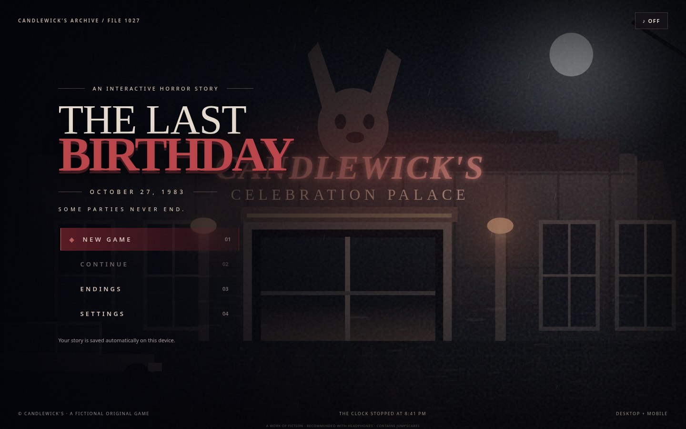

# THE LAST BIRTHDAY — 1983 🎂🐰

**A complete, playable, first-person, choice-driven horror visual novel for GitHub Pages.**

*Some parties never end.*



## 🎮 Play / Publish

1. Download and extract the project ZIP.
2. Create a new public GitHub repository. **Upload everything inside this folder** (not the containing folder) so `index.html` sits in the repository root.
3. On GitHub, open **Settings → Pages → Build and deployment → Deploy from a branch**.
4. Select the `main` branch and `/ (root)` folder, then **Save**.
5. Wait until GitHub publishes the site. Open the `.github.io` link that appears.
6. Choose **NEW GAME** to begin. The title screen is fully integrated into the playable story.

You can also launch locally by running `python -m http.server 8000` from this folder, then opening `http://localhost:8000`. Modern browsers block JavaScript module imports over `file://`, so **do not double-click index.html to play**; use a local server or GitHub Pages.

No NPM install, paid plugins, API keys, tracking, external hosted images, remote fonts, or third-party runtime libraries are required.

## ✨ What the playable game includes

- **Original title-screen illustration**, animated rain, depth parallax, working New Game, Continue, Endings, Settings and sound controls.
- **Original, custom SVG illustrated locations**: moonlit facade, 1973 celebration, the fire, lobby, great hall, birthday stage, arcade, staff hall, archive, security, boiler room, Edwin's office, final room, and the scare artwork.
- **A first-person narrative** from June Mercer's perspective, shown through location illustrations, clickable environmental hotspots, live dialogue and branching options.
- **A 1973 playable prologue and 1983 chapters**, with optional evidence, false leads, puzzles, blocked passages, tense encounters and alternate dialogue routes.
- **Seven outcomes**, including six major endings and an additional capture ending, with an endings gallery.
- **Automatic save/Continue**, collectibles and journal transcript, inventory, case evidence, map, composure meter and story-dependent choice locks.
- **Camera flashes, authored jumpscares**, original procedural sound ambience and responsive mobile support.
- **Accessibility controls**: reduced flashes and jumpscares, high-contrast text, adjustable typewriter speed, volume controls and keyboard shortcuts.

## 📖 Story continuity

**October 27, 1973:** June Mercer, 14, brings her little brother Robin, 7, to Candlewick's Celebration Palace. Edwin Candlewick had ordered emergency exits chained against safety warnings from Ruth Hale. A catastrophic fire breaks out. Robin dies in the disaster.

**October 27, 1983:** June, now 24, returns to the abandoned palace just before its demolition. She finds evidence that Edwin deliberately concealed the chained exits from investigators. A decaying, towering birthday mascot, Mr. Morrow, moves silently in the old halls. June must decide what to expose, destroy, and leave behind.

**Mr. Morrow is entirely mute in 1983.** No whispering, imitated voices, child-voice experiments, researcher backstory, or present-day dialogue. Only the **1973 version** performs prerecorded cheerful birthday greetings.

**Ruth Hale does not appear in person in 1983**; her role is revealed through warnings, memos and other archival records.

## ⌨️ Controls

| Control | Action |
|---|---|
| Click/tap choices (or scene hotspots) | Explore / choose a consequence |
| `1`–`9` | Select visible choice |
| Tap dialogue or `Enter` | Reveal dialogue immediately |
| `J` | Case journal |
| `I` | Inventory |
| `M` | Palace map |
| `F` | Flashlight cursor effect |
| `Esc` | Pause / close dialog |

Mobile is fully playable by touch. Some room hubs have many choices; scroll within the choice area for later options.

## 🧩 Puzzles and outcome access (minor spoilers)

- Arcade terminal: the **month/day** of the final birthday, `1027`.
- Edwin's safe: **day/month**, `2710`.
- Staff areas: find the backstage employee badge or force the door.
- Edwin's office: take the key from Security.
- Final corridor: open the emergency bypass valve, take the signed exit order and recover at least three clues.
- Investigators ending: the signed order and at least four evidence pieces.
- Fire ending: take matches from Edwin's office.
- Deal ending: confront Edwin and hear his offer.

## 🔧 Project structure

```text
index.html                Integrated working title screen and game UI
style.css                 Original responsive cinematic game design
js/story.js               Story scenes, branching paths, outcomes and items
js/game.js                Runtime, interaction, save, particles and audio
assets/scenes/*.svg       14 original vector game backgrounds (no supplied images)
assets/ui/favicon.svg     Original game icon
preview-menu.png          Screenshot generated from the playable game
preview-game.png          Screenshot generated from the playable game
preview-mobile.png        Mobile interface screenshot
GAME_DESIGN_BIBLE.md      Story world, characters, sound and production notes
package.json              Optional automated static test configuration
tests/validate.mjs        Complete link and asset validation
```

## ✅ Testing

Run `npm test` to validate that **every story destination exists**, all SVG scene art is available, all item/evidence references are valid, and all seven outcomes are linked.

The optional `tests/browser_qa.py` performs browser UI and branching tests in Playwright Chromium. The test uses an in-memory equivalent document to run in restricted environments (where browser navigation is prohibited). It is not required for your website to run.

**Scope clarity:** This is a finished *playable illustrated visual-novel experience*, **not a photorealistic 3D adventure**, and the uploaded art was used **only for style and continuity reference**. The playable game uses original SVG environments, story text and code, not any supplied reference pictures. Real voice acting, photorealistic models, cinematic animation and a large external soundtrack are outside this build.

